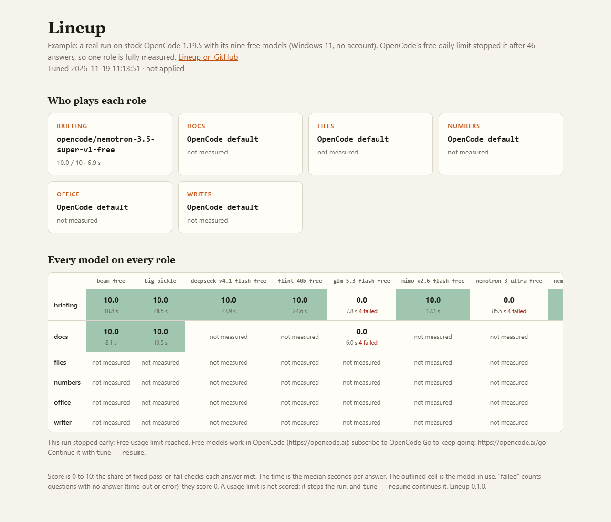

# Lineup

A team of six role agents for [OpenCode](https://opencode.ai) that picks its own models. Lineup asks every model you have the same fixed questions on your own machine, scores the answers pass or fail, and writes the best model for each role into the agent files. It keeps a backup, checks that every changed agent still answers, and puts everything back if one does not.



The picture is the score page of a real run, also at [juw12.github.io/lineup](https://juw12.github.io/lineup/). It is mostly empty for a reason: see [The example run](#the-example-run).

## What you get

Six agents you can pick in OpenCode (Tab in the terminal, the agent menu in the desktop app) or call as subagents:

| Agent | Job | May edit files | May run commands |
|---|---|---|---|
| `lineup-files` | find, list, read and compare files | no | no |
| `lineup-docs` | summarise, extract and restructure text | asks first | no |
| `lineup-numbers` | growth, margin, interest and other business arithmetic | no | no |
| `lineup-writer` | titles, hooks, posts, plain-English rewrites | asks first | no |
| `lineup-office` | totals and groupings on CSV and text data, small scripts | asks first | asks first |
| `lineup-briefing` | a short, linked briefing from feeds, pages and notes | no | no |

And one command, `tune`, that decides which model each of them uses.

## What it is not

Lineup is a thin layer on OpenCode: six agent files and one Python script. It is not a chat app, it has no messaging channels and no scheduler, and nothing runs in the background. If you want a full assistant app, this is not one.

## Install

You need OpenCode with at least one working model, and Python 3.9 or newer. No Python packages are installed.

```
git clone https://github.com/juw12/lineup
cd lineup
python lineup.py install
```

Restart OpenCode and the six agents are there. `python lineup.py uninstall` removes them again and touches nothing else.

## Tune

```
python lineup.py tune --models provider/model-a,provider/model-b,provider/model-c
```

Without `--models`, Lineup uses every model that `opencode models` lists. If that is more than 12, it asks you to choose.

What happens:

1. **Roll call.** Every model gets one short question. A model that does not answer in 60 seconds is left out, so a retired model costs one question, not all of them.
2. **Questions.** Each role has two fixed tasks (in `tasks.json`), so a model answers 12 questions per run. `--runs 2` asks everything twice.
3. **Score.** Every task has pass-or-fail checks, for example "exactly 3 bullets", "the sum is 4,815.50", "the three newest links, in order, and no other". The score is the share of checks passed, from 0 to 10. No model judges another model.
4. **Pick.** The best score wins a role. On equal scores the faster model wins, and the model you already use stays.
5. **Apply.** Lineup copies the agent files to `~/.lineup/backups/`, writes the new `model:` lines, and asks each changed agent one question. If any of them does not answer, all files are put back.

Other commands:

```
python lineup.py tune --dry-run     score only, change nothing
python lineup.py tune --resume      continue a run that a usage limit stopped
python lineup.py status             the current lineup
python lineup.py report             open the score page
```

If a provider refuses more questions (a usage or rate limit), Lineup stops asking, changes no agent, and keeps every answer it already has. The same command with `--resume` continues from there, for up to 7 days.

Results stay on your machine in `~/.lineup` (`results.jsonl`, `lineup.json`, `report.html`).

## The example run

19 November 2026, Windows 11, stock OpenCode 1.19.5, no account, its nine free models, every question asked twice. That is 216 questions. The raw log is [docs/example-run.log](docs/example-run.log).

The run did not finish. After 46 answers nothing came back any more, and a direct check a few minutes later showed OpenCode's message "Free usage limit reached", with about 20 hours until the next try. So one role of six is fully measured:

| Model (briefing role, 4 answers each) | Score | Median time |
|---|---|---|
| nemotron-3.5-super-vl-free | 10 | 6.9 s |
| beam-free | 10 | 10.8 s |
| mimo-v2.6-flash-free | 10 | 17.1 s |
| nemotron-3.5-lightning-free | 10 | 20.5 s |
| deepseek-v4.1-flash-free | 10 | 23.9 s |
| flint-40b-free | 10 | 24.6 s |
| big-pickle | 10 | 28.5 s |
| glm-5.3-flash-free | 0 | no answer: OpenCode reports the model as retired |
| nemotron-3-ultra-free | 0 | no answer after about 85 s, four times |

What this run showed:

- Two of the nine listed models could not be used at all. A list of models is not a list of working models.
- The seven working models all passed both briefing tasks, so the pick came down to speed, and the fastest was about four times faster than the slowest.
- A free plan cannot pay for 216 questions in a day. That run saved its results only at the end and scored refused questions as 0. Roll call, stop on a usage limit, saving every answer at once and `--resume` were added because of it, and are covered by tests. Checked afterwards on the same machine: with the limit still active, `tune` left both models out at the roll call and changed nothing.

A dry run of one model (big-pickle) on all twelve questions earlier that day passed eleven. The twelfth failed because the agent asked for permission to run a command; that task now says "without running a command".

## Your own tasks

The built-in tasks are a floor: they catch models that are retired, slow, or that ignore a format. They are too easy to rank good models against each other. The useful step is to add questions from your own work to `tasks.json`:

```json
{
  "id": "numbers-my-margin",
  "prompt": "Revenue 4,200, cost 3,150. Give the gross margin as a percentage.",
  "checks": [{"type": "regex", "value": "\\b25(\\.0+)?\\s*%"}]
}
```

Check types: `regex` (must match), `absent` (must not match), `bullets` (exact number of `- ` lines), `max_words`. Files for file tasks go in `fixtures/`; write `{fixtures}` in the prompt for that folder.

## Limits

- Twelve small tasks and one or two runs are a small sample. Read a score of 10 as "passed these checks", not as "the best model".
- Pass-or-fail checks measure whether an answer is correct and in the asked format. They do not measure style or depth.
- Tested on Windows 11 with stock OpenCode 1.19.5, and on one OpenCode 2.x build, where Lineup adds `--standalone` so each question gets its own server. macOS and Linux are not tested yet.
- Every question starts OpenCode once, so a question takes seconds even on a fast model.
- I did not find another OpenCode add-on that measures models on your own machine and writes the result into the agents. If you know one, please open an issue and I will link it here.

## Where the idea comes from

The idea of ready-made role agents comes from [OpenBot](https://github.com/next-open-ai/openbot), a desktop assistant app. Lineup is written from scratch and shares no code with it. It keeps the roles, drops the separate app, and adds the measuring.

## Tests

```
python -m unittest discover -s tests
```

31 tests, no OpenCode and no network needed: they use a stand-in for the models and cover scoring, picking, install, apply and put-back, the roll call, the usage-limit stop and resume.

## License

MIT
